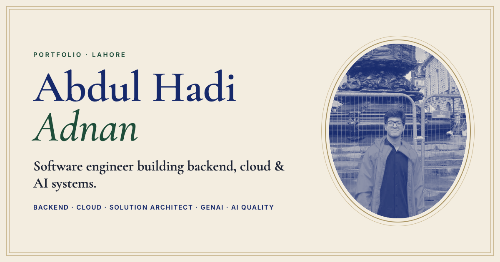
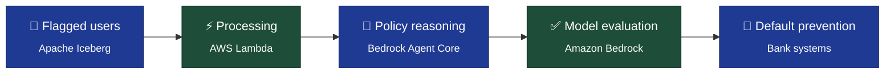

<div align="center">

<a href="https://abdul-hadi-adnan.vercel.app/">
  
</a>

<br />
<br />

<a href="https://abdul-hadi-adnan.vercel.app/"></a>
<a href="public/Abdul_Hadi_Adnan_CV.pdf"></a>
<a href="mailto:abdulhadiadnan1080@gmail.com"></a>

<br />

**Software Engineer** · Backend · Cloud · Solution Architect · GenAI · AI Quality
<br />
📍 Lahore, Pakistan &nbsp;·&nbsp; 🕒 UTC+5

</div>

---

## 👋 About

I design and ship production systems for **banks and other regulated industries**, from the first workshop to the production runbook.

Most of my work sits where software meets regulation: banking pipelines, healthcare edge cases and AI-Act compliance. I aim for systems that are **cheap to run, safe to audit and fast under load**. I write the Infrastructure as Code (AWS CDK and Terraform), I write the runbooks, and I stay in the room with stakeholders to explain the trade-offs.

## 📊 Impact at a glance

<div align="center">

| | Metric | Result |
|:-:|:--|:--|
| 🏦 | Bank users processed by one GenAI pipeline | **88,000** |
| 💸 | Daily running cost of that pipeline | **$1–10** |
| 📉 | Monthly AWS bill after a regional migration | **$45k → $22k** |
| ⚡ | Chatbot concurrency after re-architecture | **1 → 100 users** |
| 💬 | Chatbot interactions per month | **110,000** at **< 3 s** each |
| 👥 | Engineers led as Pod Lead | **5** |

</div>

## 🏗️ Featured architecture — GenAI Default-Prevention Pipeline

End-to-end infrastructure that extracts flagged users from Iceberg tables and checks them against bank and government policies, keeping the cost for **88,000 users at $1–10 a day**.



## 💼 Experience

### Software Engineer — Devsinc &nbsp;<sub>`2025 — Present`</sub>
- Owns technical design and delivery of client projects in banking and regulated domains, from discovery through production.
- Designs AWS architectures with Layer-7 security, VPCs, Transit Gateway, NACLs and hybrid connectivity.
- Leads GenAI workstreams and evaluates frontier models from Anthropic, Meta, OpenAI, xAI (Grok) and Ollama.
- Built daily Custodian compliance pipelines and developer sandboxes, and writes runbooks for every delivery.

### Freelance Cloud & GenAI Engineer — Independent &nbsp;<sub>`2021 — 2025`</sub>
- Started in quality control and fine-tuning work on frontier multimodal models, then became Pod Lead of 5 engineers.
- Led AI compliance remediation for the EU AI Act and Colorado AI Act, redesigning ML pipelines and governance.
- Shipped GenAI, computer-vision and cloud systems for healthcare, fintech, legal and banking clients under NDA.
- Delivered full Infrastructure as Code on both AWS CDK and Terraform.

## 🚀 Selected work

| Project | What it did | Outcome |
|:--|:--|:--|
| **Backend Regional Migration** | Zero-downtime migration of a bank backend to a new AWS region | **$45k → $22k / month** |
| **Scalable Cognitive Chatbot** | Rebuilt a single-EC2 chatbot as a secure, compliant Bedrock platform | **1 → 100 concurrent users** |
| **Predictive Extraction & Onboarding** | LLM pipelines that flag likely defaults, plus a new-account onboarding flow | **30-day default prediction** |
| **Sandbox & Custodian Governance** | Developer sandboxes with daily Cloud Custodian and AWS Nuke teardown | **Full audit trail** |
| **MSP Post-Sale Issue Platform** | GuardDuty-backed system routing client issues to the right manager | **Issues reach the right owner** |

## 🧰 Toolbox

<p>
  
  
  
  
  
  
  
  
  
  
  
</p>

<details>
<summary><b>Skills by role</b> (click to expand)</summary>
<br />

| Role | Proof | Skills |
|:--|:--|:--|
| **Backend Engineer** | Built the Python and Lambda backends behind the bank pipelines, and led a full backend rebuild and regional migration. | Python · Flask · API design · Event-driven systems · Microservices · SQL & NoSQL · Step Functions · SQS / SNS |
| **Cloud Engineer** | Cut a bank's AWS bill from $45k to $22k a month, and runs daily Custodian governance. | AWS · Azure · AWS CDK · Terraform · VPC · Transit Gateway · IAM · GuardDuty · CloudWatch · Cloud Custodian |
| **Solution Architect** | Owns projects from discovery workshops to production, and explains the trade-offs to non-technical stakeholders. | System design · Client workshops · Multi-cloud · Security architecture · Runbooks · Documentation |
| **GenAI & ML Engineer** | Put Bedrock agents into production for 88,000 users, and has worked on fine-tuning frontier models. | Amazon Bedrock · Agent Core · SageMaker · Fine-tuning · Knowledge graphs · Amazon Neptune · Computer vision · NLP · MLOps |
| **AI Quality & Compliance** | Led a 5-person pod focused on model quality, and led remediation work for the EU and Colorado AI Acts. | LLM evaluation · Side-by-side ranking · Rubrics · Bias mitigation · EU AI Act · Colorado AI Act · HIPAA · PIPEDA · ISO |

</details>

## 🎓 Education

- **Forman Christian College University**, Lahore — BS Computer Science · Machine Learning & Deep Learning <sub>`2026`</sub>
- **Lingnan University**, Hong Kong — Exchange Student, Data Science · Algorithms, VR/AR, Unreal Engine 5
- **Roots International / MIUC**, Lahore — Intermediate of Computer Science (ICS) <sub>`2020 — 2022`</sub>

---

## 🖥️ About this site

The live resume is an interactive single-page site with an impact ledger, a clickable architecture diagram, a hidden terminal (press <kbd>⌘</kbd> + <kbd>K</kbd> and try `sudo hire abdul`) and **Winston the dachshund** as your tour guide.

<p>
  
  
  
  
  
</p>

```bash
npm install      # install dependencies
npm run dev      # start the local dev server
npm run build    # production build into dist/
```

```text
├── public/
│   ├── Abdul_Hadi_Adnan_CV.pdf   # the CV the site offers for download
│   ├── abdul.jpg, abdul-duo.jpg  # portraits
│   ├── og.png                    # social preview image
│   └── favicon.svg
├── src/
│   ├── data.ts                   # all site content: edit this to update the resume
│   ├── App.tsx, main.tsx
│   ├── styles.css
│   └── components/               # Hero, Sections, Terminal, Guide (Winston) …
├── index.html
├── vercel.json
└── vite.config.ts
```

<div align="center">
<br />

**[🌐 abdul-hadi-adnan.vercel.app](https://abdul-hadi-adnan.vercel.app/)** &nbsp;·&nbsp; **[✉️ abdulhadiadnan1080@gmail.com](mailto:abdulhadiadnan1080@gmail.com)** &nbsp;·&nbsp; **[🐙 @abdulhadiadnan1080](https://github.com/abdulhadiadnan1080)**

</div>
